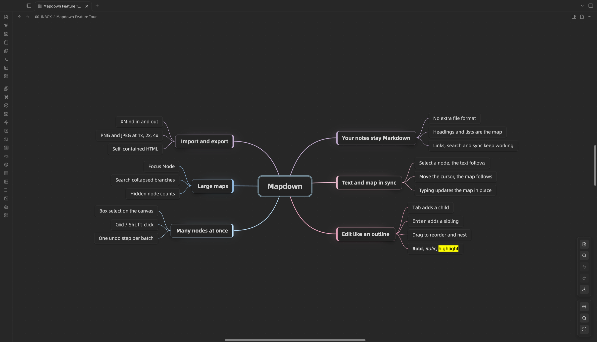
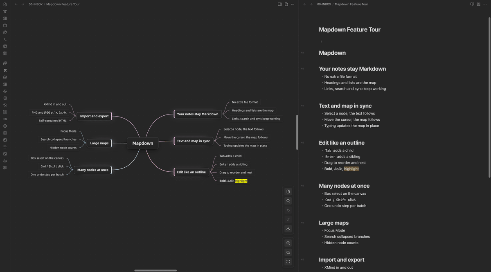
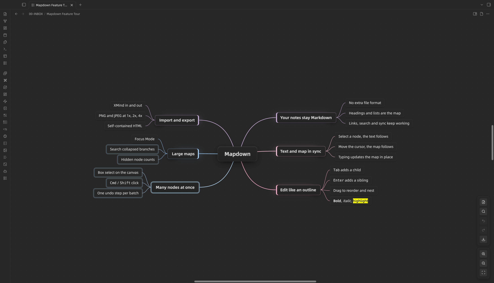

[中文说明](Readme-zh.md)

# Mapdown

**One Markdown note, two views.** Write in text, think in a mind map, and keep the two in sync.

Mapdown is an Obsidian plugin that opens your Markdown notes as editable mind maps. There is no separate file format: headings and lists are the map, and every edit in the map is saved back to the same `.md` file.



## Why Mapdown

- **Your notes stay Markdown.** The map is just another view of the note. Links, search, sync and version history keep working as they always have.
- **Text and map stay in sync.** Open the note side by side: select a node and the Markdown scrolls to its line; move the cursor in Markdown and the map follows. Typing in the text updates the map in place.
- **Built for Obsidian.** Nodes render Markdown, embeds and `[[wikilinks]]`, with hover previews and link suggestions while you type.



## Quick start

1. Install and enable Mapdown.
2. Run **Create new mindmap** from the command palette or the ribbon, or open an existing outline note and switch it to the mind map view.
3. Click **Toggle split right (Markdown)** in the map toolbar to open the same note as Markdown beside it.

A minimal mind map note:

```markdown
---
mindmap-plugin: basic
---

# Project plan

## Research
- Collect references
- Summarize findings

## Execution
- Draft outline
- Review milestones
```

When you open an ordinary note as a mind map, Mapdown asks first. You can convert the note, or save the map as a new note and leave the original untouched. Converting backs up the original text before the first edit.

## Features

### Edit like an outline

- Add children with `Tab` and siblings with `Enter`, and edit with `Space` or a double-click.
- Drag nodes to change their order and level. Hold `Ctrl` while dropping to copy instead.
- Move nodes up, down, left and right; turn the following siblings into children; join a node with the one below it.
- Bold, italic, highlight and strikethrough from commands.
- Undo and redo up to 50 steps.

### Work on many nodes at once

- Select several nodes with `Cmd/Ctrl`-click, a range of siblings with `Shift`-click, or drag a box on the empty canvas. `Cmd/Ctrl + A` selects every visible node.
- Delete, cut, copy, paste, drag, collapse, expand and format the whole selection. Each batch is a single undo step.



### Stay oriented in large maps

- Focus Mode dims everything outside the selected branch.
- Expand or collapse one level at a time. Collapsed nodes show how many nodes they hide.
- Search every node, including collapsed branches, and jump between matches without changing the zoom.
- The map fits the window when it opens. Pan with the trackpad, the wheel, or a right or middle mouse drag.

### Part of your vault

- Nodes render bold, italics, highlights, code, tables, images and embeds.
- Click an internal link to open the note in the current tab, a new tab or a new window. Hover over it for a preview.
- Type `[[` while editing to get file suggestions.
- External edits, unsaved drafts and renames are handled without losing your changes.

### Import and export

- **XMind import:** drop a `.xmind` file onto a map, run **Import from XMind…**, or right-click a `.xmind` file in the file list. Import always creates new notes, one per sheet, and never overwrites a map. It works with XMind 2020 and later (including XMind Zen) and XMind 8, and keeps topics, hierarchy, floating topics, links, notes, folding, labels, priorities and task markers.
- **XMind export:** export the whole map as a `.xmind` file that XMind 2020 and later can open, with folding, links, notes, labels, priorities and task markers kept.
- **Images:** PNG and JPEG at true 1x, 2x or 4x resolution.
- **HTML:** a self-contained page with the exported image embedded.

## Keyboard shortcuts

| Key | Action |
| --- | --- |
| `Tab` | Add a child node |
| `Enter` | Add a sibling node, or finish editing |
| `Space` / double-click | Edit the selected node |
| `Delete` / `Backspace` | Delete the selected nodes |
| Arrow keys | Move between nodes |
| `Home` | Select the root node |
| `F` | Toggle Focus Mode |
| `Esc` | Exit Focus Mode, cancel editing, or clear the selection |
| `Cmd/Ctrl + A` | Select all visible nodes |
| `Cmd/Ctrl + Z` / `Cmd/Ctrl + Y` | Undo / redo |
| `Cmd/Ctrl` + mouse wheel | Zoom |

Every action is also available as a command, so you can assign your own hotkeys.

## Settings

| Setting | What it does |
| --- | --- |
| Canvas size and background | Size and color of the map canvas |
| Heading levels | How many top levels are saved as Markdown headings; deeper nodes become list items |
| Font size | Base text size; each level scales from it |
| Node glow and maximum width | How nodes look and where long text wraps |
| Layout direction | Both sides, one side, or clockwise |
| Branch colors | Color preset for branches |
| Center after moving | Recenter on a node after it moves |
| Focus overlay and glow | How strongly Focus Mode dims the rest of the map |
| Link preview and open mode | Hover previews, and where clicked links open |
| Sync selection with Markdown | Turn the text–map selection sync on or off |

## Limitations

- Desktop only. Editing relies on the keyboard, drag and drop, and hover.
- Mapdown is for structuring notes, not for diagram design. It has no themes, callouts or free-form drawing.
- XMind import skips images, summaries, boundaries, relationships, callouts and styles. The completion notice lists what was skipped.
- XMind export removes Markdown formatting. A link inside a node becomes a link on the whole topic.
- XMind import and export are one-off conversions, not a live sync.
- HTML export contains an image, not an interactive map.
- Right-clicking a `.xmind` file only works when Obsidian shows all file types (Settings → Files and links → Detect all file extensions).

## Installation

### Community plugins

Once Mapdown is listed in the Obsidian community plugin directory:

1. Open **Settings → Community plugins**.
2. Search for `Mapdown`.
3. Install and enable it.

### Manual

1. Download `manifest.json`, `main.js` and `styles.css` from the latest GitHub release.
2. Put them in `.obsidian/plugins/mapdown` inside your vault.
3. Reload Obsidian and enable Mapdown under **Community plugins**.

## Credits

Mapdown started as a fork of [Enhancing Mindmap](https://github.com/markmindckm/obsidian-enhancing-mindmap) by markmindckm, with contributions from S-e-b-G and others. Its mind map engine, node model and many editing commands come from that project. Thank you to everyone who built it.

Mapdown updates it for current versions of Obsidian and adds text–map sync, multiple selection, XMind import and export, search, safer saving, and a reworked view and toolbar.

Mind maps saved by Enhancing Mindmap open in Mapdown unchanged: both use the `mindmap-plugin: basic` frontmatter.

Mapdown was previously called MindMark. Maps made with MindMark open unchanged.

## Development

```bash
npm install
npm run check   # type check, regression tests and production build
npm run e2e     # interaction tests against a running Obsidian
```

The build produces `main.js`; release files are `manifest.json`, `main.js` and `styles.css`.

## License

MIT. See [LICENSE.md](LICENSE.md).
