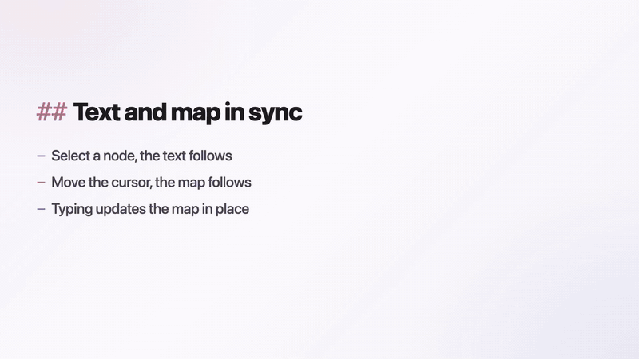
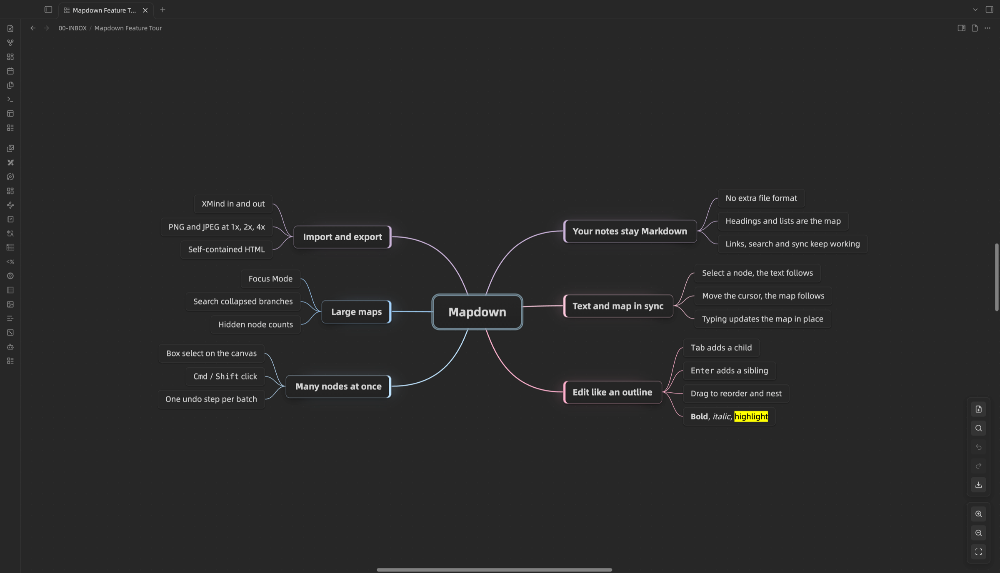
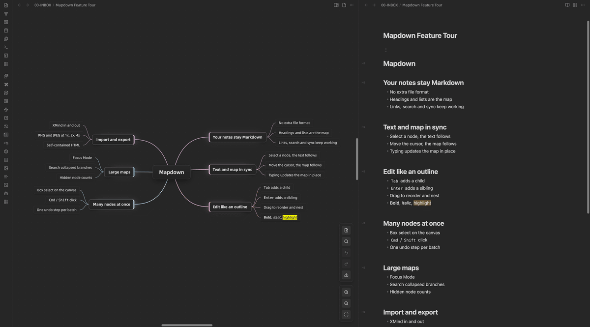
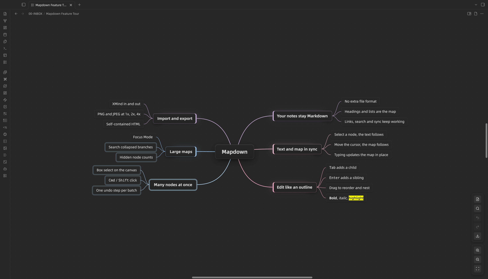

> **本仓库已归档。Mapdown 0.3.x 已由 Mapdown 1.0 取代，新版本在 [leftlive/mapdown](https://github.com/leftlive/mapdown)。**

[English](README.md)

# Mapdown 文图

**一篇 Markdown，两种看法。** 写作时用文本，整理时用导图，两边实时同步。

Mapdown（中文名“文图”）是一个 Obsidian 插件，把 Markdown 笔记作为可编辑的思维导图打开。它没有私有文件格式：标题和列表就是导图的结构，在导图里做的每一次修改都保存回同一个 `.md` 文件。



<!-- 带声音的宣传片：把 mapdown-launch-720p.mp4 上传后 GitHub 给的 user-attachments 链接单独一行放在这里。 -->



## 为什么用 Mapdown

- **笔记始终是 Markdown。** 导图只是同一篇笔记的另一种看法，双链、搜索、同步和版本历史都照常工作。
- **文本和导图实时联动。** 左右分屏打开同一篇笔记：在导图里选中节点，Markdown 滚到对应的行；在 Markdown 里移动光标，导图跟着选中。在文本里打字时，导图就地更新。
- **融入 Obsidian。** 节点里能显示 Markdown、嵌入内容和 `[[双链]]`，支持悬停预览，输入时联想文件。



## 快速开始

1. 安装并启用 Mapdown。
2. 在命令面板或左侧功能区执行 **创建新思维导图**；也可以打开一篇已有的大纲笔记，切换到导图视图。
3. 点击导图工具栏的 **向右分屏显示 Markdown**，在旁边打开同一篇笔记的文本。

一篇最简单的导图笔记：

```markdown
---
mindmap-plugin: basic
---

# 项目计划

## 调研
- 收集资料
- 整理结论

## 执行
- 起草大纲
- 检查里程碑
```

把一篇普通笔记作为导图打开时，Mapdown 会先询问：可以转换这篇笔记，也可以另存为新导图、不改动原笔记。选择转换时，第一次编辑前会自动备份原文。

## 功能

### 像大纲一样编辑

- `Tab` 新增子节点，`Enter` 新增同级节点，`空格` 或双击编辑。
- 拖动节点调整顺序和层级；松开时按住 `Ctrl` 则改为复制。
- 上下左右移动节点；把后面的兄弟节点收为子节点；与下一个节点合并。
- 用命令设置加粗、斜体、高亮、删除线。
- 撤销和重做，最多 50 步。

### 一次处理多个节点

- `Cmd/Ctrl` + 单击逐个多选，`Shift` + 单击选中一段兄弟节点，或在空白处拖出选框。`Cmd/Ctrl + A` 选中全部可见节点。
- 选中的节点可以一起删除、剪切、复制、粘贴、拖动、折叠、展开和设置格式，每次批量操作只算一步撤销。



### 大图也不迷路

- 专注模式淡化当前分支以外的内容。
- 逐层展开或折叠；折叠的节点会显示隐藏了多少个节点。
- 搜索全部节点，包括折叠的分支，在匹配项之间跳转时不改变缩放。
- 打开导图时自动适配窗口。用触控板、滚轮、右键拖动或中键拖动平移画布。

### 属于你的知识库

- 节点里能显示加粗、斜体、高亮、代码、表格、图片和嵌入内容。
- 点击双链可以在当前标签页、新标签页或新窗口中打开目标笔记，悬停可以预览。
- 编辑时输入 `[[` 联想文件。
- 外部修改、未保存的草稿和文件重命名都能妥善处理，不会丢失改动。

### 导入与导出

- **导入 XMind：** 把 `.xmind` 文件拖到导图上、执行 **从 XMind 导入…**，或在文件列表里右键 `.xmind` 文件。导入总是新建笔记，每张画布一篇，不会覆盖已有导图。支持 XMind 2020 及以后的版本（含 XMind Zen）和 XMind 8，保留主题、层级、自由主题、链接、备注、折叠状态、标签、优先级和任务标记。
- **导出 XMind：** 把整张导图导出为 `.xmind` 文件，XMind 2020 及以后的版本可以打开，折叠状态、链接、备注、标签、优先级和任务标记都会保留。
- **图片：** PNG 和 JPEG，真实的 1x、2x、4x 分辨率。
- **HTML：** 内嵌导出图片的独立网页文件。

## 快捷键

| 按键 | 操作 |
| --- | --- |
| `Tab` | 新增子节点 |
| `Enter` | 新增同级节点，或结束编辑 |
| `空格` / 双击 | 编辑选中的节点 |
| `Delete` / `Backspace` | 删除选中的节点 |
| 方向键 | 在节点之间移动 |
| `Home` | 选中根节点 |
| `F` | 开关专注模式 |
| `Esc` | 退出专注模式、取消编辑或取消选中 |
| `Cmd/Ctrl + A` | 选中全部可见节点 |
| `Cmd/Ctrl + Z` / `Cmd/Ctrl + Y` | 撤销 / 重做 |
| `Cmd/Ctrl` + 滚轮 | 缩放 |

所有操作也都是命令，可以自己绑定快捷键。

## 设置

| 设置 | 作用 |
| --- | --- |
| 画布尺寸和背景 | 导图画布的大小和颜色 |
| 标题层级 | 前几层保存为 Markdown 标题，更深的节点保存为列表项 |
| 字号 | 基础字号，各层级按它缩放 |
| 节点外发光和最大宽度 | 节点的外观，以及长文字在哪里换行 |
| 布局方向 | 两侧、单侧或顺时针 |
| 分支配色 | 分支颜色预设 |
| 移动后居中 | 节点移动后让视图对准它 |
| 专注遮罩和光晕 | 专注模式下其余部分淡化的程度 |
| 双链预览和打开方式 | 悬停预览，以及点击双链在哪里打开 |
| 与 Markdown 同步选中 | 开关文本和导图之间的选中联动 |

## 局限

- 只支持桌面端：编辑依赖键盘、拖放和鼠标悬停。
- Mapdown 用来整理笔记结构，不是专业制图工具：没有主题模板、标注和自由绘图。
- 导入 XMind 时，图片、概要、外框、关联线、标注和样式不会导入，完成提示会列出跳过了哪些内容。
- 导出 XMind 时会去掉 Markdown 格式；节点中间的链接会变成整个主题的链接。
- XMind 导入和导出都是一次性转换，不会自动同步。
- HTML 导出的是一张图片，不是可交互的导图。
- 右键 `.xmind` 文件导入，需要先让 Obsidian 显示所有类型的文件（设置 → 文件与链接 → 检测所有类型的文件）。

## 安装

### 社区插件

Mapdown 上架 Obsidian 社区插件市场后：

1. 打开 **设置 → 第三方插件**。
2. 搜索 `Mapdown`。
3. 安装并启用。

### 手动安装

1. 从 GitHub 最新的 Release 下载 `manifest.json`、`main.js` 和 `styles.css`。
2. 放到知识库的 `.obsidian/plugins/mapdown` 目录里。
3. 重新加载 Obsidian，在 **第三方插件** 中启用 Mapdown。

## 来源

Mapdown 基于 [Enhancing Mindmap](https://github.com/markmindckm/obsidian-enhancing-mindmap)（MIT 许可）修改而来，导图引擎、节点模型和许多编辑命令都来自这个项目，原版权声明保留在 [LICENSE.md](LICENSE.md) 中。

Mapdown 在此基础上适配了新版 Obsidian，并新增了文本与导图联动、多选、XMind 导入导出、搜索、更安全的保存，以及重做的视图和工具栏。

Enhancing Mindmap 保存的导图可以直接在 Mapdown 中打开，两者都使用 `mindmap-plugin: basic` 这个 frontmatter。

Mapdown 曾用名 MindMark，用 MindMark 创建的导图可以直接打开。

## 开发

```bash
npm install
npm run check   # 类型检查、回归测试和生产构建
npm run e2e     # 在运行中的 Obsidian 里跑交互测试
```

构建生成 `main.js`；发布文件是 `manifest.json`、`main.js` 和 `styles.css`。

## 许可

MIT，见 [LICENSE.md](LICENSE.md)。
